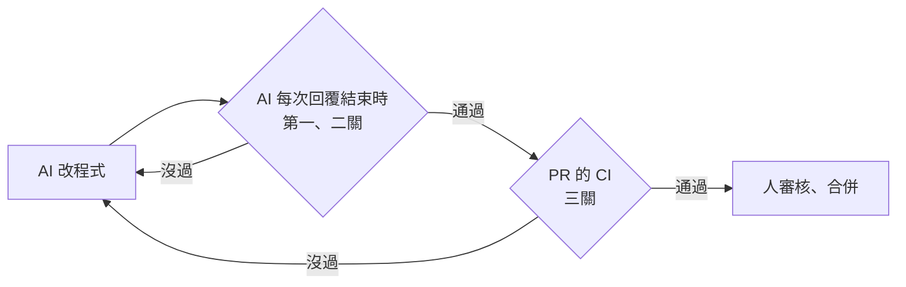

# quality-referee

AI 寫程式的速度，人已經來不及逐行審。quality-referee 用三道機器量測的關卡把關：沒過就退回給 AI 重做，全過了才輪到人看。

## 要解決的問題

- **人審不完。** AI 代理人幾分鐘產出的程式，人要花幾小時讀。逐行審查變成瓶頸，不然就是流於形式。
- **寫給 AI 的規範擋不住東西。** 提示詞裡的程式碼規範對 AI 只是建議，可以忽略，沒有任何機制會把不合規的程式擋在版本庫外面。
- **出事負責的還是人。** AI 不能替系統負責，按合併的人要。沒有逐行讀過的程式，要有可信的數字才簽得下去。

做法是把「請寫好測試」換成量得出來、過不了就擋下的門檻。背景和論證見 [教材/企業級AI代理人品質驗證與自動化防線架構指南.md](教材/企業級AI代理人品質驗證與自動化防線架構指南.md)。

## 三道關

| 關 | 量什麼 | 擋下什麼 |
|---|---|---|
| 1. 單元測試 | 專案的測試指令（例如 `go test ./...`）要全部通過 | AI 改東西時把原本會動的行為改壞 |
| 2. CRAP | 這次改到的函式，CRAP 分數不能超過門檻（預設 12） | 又複雜又沒測試的函式 |
| 3. 抓錯檢查（mutation testing） | 工具把這次改到的程式故意改壞一點，測試要抓得到 | 跑得到程式、卻什麼都沒驗證的測試 |

- **CRAP**：函式越複雜（分支越多）、被測試跑到的越少，分數越高。公式是 `複雜度² × (1 − 覆蓋率)³ + 複雜度`，所以覆蓋率 100% 時分數等於複雜度；複雜度 3、完全沒測試剛好是 12 分。超標時報告會說要拆函式，還是覆蓋率要補到多少。
- **抓錯檢查**的三個條件：
  - **抓錯率**：測試跑得到的改壞版本裡，有幾成被測試抓到（預設至少 80%）。
  - **測到率**：全部改壞版本裡，有幾成被測試跑到（預設至少 50%）。
  - 改到的每個函式，至少要有一個改壞的版本被抓到。
  - 例子：工具做出 10 個改壞的版本，測試跑到其中 8 個，8 個裡有 6 個讓測試失敗。測到率是 8 ÷ 10 = 80%，抓錯率是 6 ÷ 8 = 75%，低於 80%，第三關沒過。
- **只看這次改到的。** 第二、三關比對 base 分支（例如 `origin/main`），只檢查這次改到的函式和行。舊程式沒改到的不會擋你；改到了舊函式裡的一行，那個函式就要及格。



- **AI 自己會被擋下。** Claude Code 每次回覆結束時，Stop hook（Claude Code 在 AI 回覆結束時自動執行的腳本）跑第一、二關，沒過就把訊息交回 AI 繼續修；這次沒改任何東西時直接放行。PR 進 main 時 CI 跑完整三關，人手寫的 PR 也一樣。
- **AI 不能靠改規則過關。** CI 讀的門檻和設定是 base 分支上的版本，在 PR 裡改鬆不會生效（見「把規則鎖起來」）。
- **人審的是數字量不出來的部分。** 測試有沒有被刪或改鬆、排除的理由成不成立、門檻訂多少。
- **AI 可以替專案把三道關建起來。** Go 和 C# 專案沒有測試時，照附的指引量現況、補測試（見「讓 AI 建立測試」）。

## 支援的語言和工具

這個工具分成兩部分：

- **裁判**：這個 repo 本身（`referee.py`）。找出這次改到什麼、算分數、判定過不過。它不認得任何語言。
- **檢查員**：一支指令，負責實際量測某個語言的程式（跑覆蓋率、產生改壞的版本），把原始數字寫成一份 JSON（**記分表**）交給裁判。

| 情況 | 能不能用 |
|---|---|
| Go | 可以，有現成的檢查員（`inspectors/go.py`） |
| C#（SDK 風格的 .NET 6 以上） | 可以，有現成的檢查員（`inspectors/csharp.py`）。還在試驗階段：還沒在真實專案、.NET 6～9 的 SDK、CI 的 runner 上跑過，見 [docs/驗證狀態.md](docs/驗證狀態.md) |
| 其他語言 | 第一關（只跑測試指令）可以直接用：照「安裝到專案」複製 Go 的範本，`.referee.json` 的 `gates` 只留 `["test"]`、改 `test.command`，workflow 把 setup-go 換成自己語言的步驟。第二、三關要自己寫檢查員（見「自訂檢查員」） |
| 不用 Claude Code | 可以。裁判的指令和 CI 跟 AI 工具無關；少的是「AI 回覆結束時自動擋下」這一層，只剩 CI 擋。`.claude/` 底下的範本和 `CLAUDE.md` 是 Claude Code 專用 |
| 不用 GitHub | 範本只有 GitHub Actions 的 workflow 和 CODEOWNERS。Gitea 的放法見「安裝到專案」，其他 CI 要照範本自己改寫 |

需求：

- Python 3.8 以上，只用標準函式庫。這份文件的指令都寫 `python`；機器上只有 `python3`（例如 macOS）時，指令都換成 `python3`，`.referee.json` 裡 `inspector` 的 `"python"` 也要改。
- Go 檢查員：Go。第一次執行時用 `go install` 裝 gocyclo（算複雜度）、gremlins（產生改壞的版本），要網路。
- C# 檢查員：.NET SDK 6 以上。第一次執行時建置複雜度工具、裝 Stryker.NET（產生改壞的版本），要網路。
- Windows：Stop hook 的 `gate.sh` 要用 Git for Windows 的 bash 執行，安裝指令也在 Git Bash 裡跑。

## 安裝到專案

用 git submodule 把這個 repo 掛在 `tools/referee/`，再把範本複製到專案裡。以 Go 專案為例，在專案根目錄：

```
git submodule add <這個 repo 的網址> tools/referee
cp tools/referee/templates/go/.referee.json .
cp tools/referee/templates/go/.referee-equivalents.json .
mkdir -p .github/workflows
cp tools/referee/templates/go/workflows/go.yml .github/workflows/referee.yml
cp tools/referee/templates/go/CODEOWNERS .github/CODEOWNERS

# 以下是 Claude Code 專用，不用 Claude Code 可以跳過
mkdir -p .claude/hooks .claude/skills
cp tools/referee/templates/go/.claude/settings.json .claude/
cp tools/referee/templates/go/.claude/hooks/gate.sh .claude/hooks/
cp -r tools/referee/templates/go/.claude/skills/referee-onboard .claude/skills/
cp tools/referee/templates/go/CLAUDE.md .
```

C# 專案：把上面的 `templates/go` 都換成 `templates/csharp`，複製 workflow 的那一行換成：

```
cp tools/referee/templates/csharp/workflows/csharp.yml .github/workflows/referee.yml
```

範本裡除了 workflow 都是點開頭的檔案，`ls` 看不到，要用 `ls -a`。用 Gitea 的話，workflow 放 `.gitea/workflows/referee.yml`。

接著：

1. **調整 `.referee.json`**（見「設定檔」）。至少確認 `sources`、`tests`、`exclude` 和 `test.command` 符合專案；只有 `python3` 的機器要改 `inspector`（見「需求」）。
2. **專案原本就有的檔案不要整份覆蓋。** 已有 `CLAUDE.md` 時，把範本的內容加進去；已有 `.claude/settings.json` 時，合併 `permissions.deny` 和 `hooks.Stop`。
3. **掃整個 repo 的檢查要豁免 `tools/referee/`。** 例如掃全部 `.md` 連結、掃全部原始碼風格的測試。submodule 裡是這個工具自己的文件和程式，不是專案的內容。
4. **先在本機量一次現況**：

   ```
   python tools/referee/referee.py test
   python tools/referee/referee.py crap
   ```

   不帶 `--base` 的 `crap` 會列出整個專案超標的函式。很多函式不及格是正常的：平常只檢查改到的，這份表是之後補測試的清單。
5. **commit 並送第一個 PR。** 這個 PR 的 CI 用的是 PR 分支上的設定檔（main 上還沒有），審的人要特別看 `.referee.json`。
6. **把規則鎖起來**（見下一節）。沒做這一步，AI 卡關時可以直接改門檻。
7. 其他人 clone 專案時要加 `--recurse-submodules`，或 clone 之後執行 `git submodule update --init`。

**不想一次上三關**：把 `.referee.json` 的 `gates` 改成只有 `["test"]`，穩定後再加 `crap`、`mutation`。沒啟用的關會印「還沒啟用」並通過，workflow 不用改。怎麼分階段導入、技術債怎麼處理，見 [教材/導入步驟_三道檢查.md](教材/導入步驟_三道檢查.md)。

**升級**：改 submodule 指到的版本，再看 [CHANGELOG.md](CHANGELOG.md)。範本複製出去的檔案（例如 `gate.sh`、workflow）有改的話，要重新複製。

## 把規則鎖起來

範本已經設好兩層：Claude Code 不能用編輯工具改規則檔，CI 讀 base 分支上的設定。第三層要自己設：把 `.github/CODEOWNERS` 裡的 `@your-org/quality-owners` 換成實際負責審核的人，並在 GitHub 設 main 的分支保護。要勾哪些選項、每一層擋什麼、還有哪些改法擋不住，見 [docs/鎖定規則.md](docs/鎖定規則.md)。

副作用：裝好之後，Claude Code 的編輯工具不能改 `.github/`、`.claude/` 底下的任何檔案（例如別的 workflow），要改時由人改；改 `.github/`、`.claude/`、`CLAUDE.md` 的 PR 都要 CODEOWNERS 裡的人核准。

## 讓 AI 建立測試

專案還沒有測試，或舊程式要補測試時，可以交給 AI 做。目前限 Go 和 C#；其他語言要先有檢查員。

範本的 `CLAUDE.md` 寫了平常改程式要守的規則；`.claude/skills/referee-onboard/` 是 Claude Code 的 skill，請 AI「替這個專案建立三道品質關」時會用到。兩者都指向 [docs/AI導入指引.md](docs/AI導入指引.md)，用別的 AI 工具時，直接請它讀 `tools/referee/docs/AI導入指引.md`。

指引要 AI 做的事：量整個專案的現況、建立測試骨架、照 CRAP 的表由上往下補測試、用抓錯檢查確認測試抓得到錯。測試寫不出來時（函式太大、直接碰時鐘或檔案系統、沒有依賴反轉），AI 要停下來回報程式結構的問題，不能硬測。

人還是要看 AI 寫的測試。替舊程式補的測試記錄的是現有的行為，現有的錯誤也會被當成正確答案；指引要求 AI 把這種測試標出來，審的時候先看這些。

## 日常使用

裝好之後平常不用手動跑：Claude Code 每次回覆結束時 `gate.sh` 跑第一、二關，PR 進 main 時 CI 跑三關（細節見 [docs/Hook與CI.md](docs/Hook與CI.md)）。想自己跑時：

```
python tools/referee/referee.py test
python tools/referee/referee.py crap --base origin/main
python tools/referee/referee.py mutation --base origin/main --json mutation.json
python tools/referee/referee.py check --base origin/main --skip mutation --json reports/
```

| 指令 | 做什麼 |
|---|---|
| `test [--json 檔]` | 第一關，執行 `test.command` |
| `crap [--base B] [--json 檔]` | 第二關。有 `--base` 只檢查改到的函式，沒給就檢查整個專案。超標的函式後面附改善方向：「要拆函式」或「覆蓋率要到 X%」 |
| `mutation [--base B] [--json 檔]` | 第三關。有 `--base` 只算改到的行、只看改到的函式。除了兩個比例，每個函式至少要有一個改壞的版本被抓到，不然列出來並判沒過 |
| `check [--base B] [--skip 關...] [--json 目錄]` | 已啟用的關依 test → crap → mutation 的順序跑，第一個沒過就停，印出「停在第 N 關」。`--json` 每一關寫一份：`test.json`、`crap.json`、`mutation.json` |

結束碼：0 通過，1 沒過門檻，2 量測失敗或設定有誤。

`--base` 比對的是「和 base 的共同祖先相比，這次改了哪些行」，含還沒 commit 的修改和還沒加入 git 的新檔案；改名的檔案只算真的改到的行。四個指令都可以加 `--config-from <分支>`，改讀那個分支上的設定檔；CI 用它，本機平常不用加。

**沒過時怎麼辦**：

- 第一關：修程式或測試，讓測試通過。
- 第二關：照報告的建議拆函式，或補測試到報告說的覆蓋率。
- 第三關：報告會列出沒抓到和測試沒跑到的改壞版本（在哪一行、改了什麼）。沒抓到的補斷言，沒跑到的補測試。真的「怎麼改結果都一樣」的，寫進排除清單 `.referee-equivalents.json`，交給人核准（格式見 [docs/合約.md](docs/合約.md)）。

## 設定檔 `.referee.json`

Go 範本的內容：

```json
{
  "version": 1,
  "base": "origin/main",
  "gates": ["test", "crap", "mutation"],
  "sources": ["**/*.go"],
  "tests": ["**/*_test.go"],
  "exclude": ["tools/referee/", "vendor/"],
  "test": {"command": ["go", "test", "./..."]},
  "crap": {"threshold": 12, "inspector": ["python", "tools/referee/inspectors/go.py", "functions"]},
  "mutation": {"kill_rate_threshold": 80, "reach_rate_threshold": 50,
               "exclude_mutators": [], "equivalents_file": ".referee-equivalents.json",
               "inspector": ["python", "tools/referee/inspectors/go.py", "mutants", "--workers", "4"]}
}
```

C# 範本見 [templates/csharp/.referee.json](templates/csharp/.referee.json)。未知的鍵、型別不對都是結束碼 2，不會默默改用預設值。每個鍵的預設值和規則、`sources`、`tests`、`exclude` 的比對規則、排除清單的格式，都在 [docs/合約.md](docs/合約.md)。`inspector` 指令可以帶的參數見 [docs/Go檢查員.md](docs/Go檢查員.md)、[docs/CSharp檢查員.md](docs/CSharp檢查員.md)。

## 自訂檢查員

標準檢查員量不了的語言或專案，在專案裡寫一支程式，用什麼語言寫都可以，把 `crap.inspector`（或 `mutation.inspector`）換成啟動它的指令：

- **輸入**：環境變數 `REFEREE_CONTEXT` 是一個 JSON 檔的路徑，裡面有這次是哪一關、`sources`、`tests`、`exclude`、改到的檔案。
- **輸出**：把記分表寫到環境變數 `REFEREE_OUT` 給的檔案路徑，量完結束碼 0。第二關交函式表（每個函式的位置、複雜度、覆蓋率），第三關交改壞版本表（每個改壞的版本在哪、有沒有被抓到）。
- **格式錯時**：裁判以結束碼 2 停下，指出哪一項哪個欄位錯。

欄位的完整規格在 [docs/合約.md](docs/合約.md)；`inspectors/go.py` 和 `inspectors/csharp.py` 是完整的例子。

檢查員的程式放在專案裡時，它的目錄要加進 `exclude`（不然會被當成專案的程式量測），也要列進 `.github/CODEOWNERS`（不然 PR 可以改檢查員讓數字變好看）。

## 擋不住什麼

三道關量的是數字，下面這些要靠人：

- **測試的正確答案錯了，三關照樣全過。** 測試照著程式的輸出寫，或替舊程式補的測試把現有的錯誤當成正確答案，工具都看不出來。人要看測試的正確答案對不對。
- **完全沒有測試的專案，第一關會通過。** 測試指令在沒有測試時結束碼也是 0。
- **「每個函式至少抓到一個」只要求一個。** 函式只測了一條路徑也算過，測試夠不夠還是要看兩個比例和人審。
- **本機擋不住 AI 用 Bash 改檔**，CI 才擋得住。PR 改測試專案、建置設定或 workflow 檔，只有 CODEOWNERS 和人審擋得住。
- **沒被 `sources` 比到、或被 `exclude` 排除的檔案，三關都看不到。**

完整清單見 [docs/已知限制.md](docs/已知限制.md) 和 [docs/鎖定規則.md](docs/鎖定規則.md) 的「還擋不住的」。

## 文件

| 想知道什麼 | 看哪裡 |
|---|---|
| 防止 AI 或 PR 改門檻、改設定，以及還擋不住的改法 | [docs/鎖定規則.md](docs/鎖定規則.md) |
| 設定檔每個鍵的規則、排除清單、記分表和報告的格式 | [docs/合約.md](docs/合約.md) |
| Stop hook 和 CI workflow 的行為 | [docs/Hook與CI.md](docs/Hook與CI.md) |
| 標準檢查員的參數、需求和限制 | [docs/Go檢查員.md](docs/Go檢查員.md)、[docs/CSharp檢查員.md](docs/CSharp檢查員.md) |
| 請 AI 替專案建立測試 | [docs/AI導入指引.md](docs/AI導入指引.md) |
| 判定規則本身看不到的情況 | [docs/已知限制.md](docs/已知限制.md) |
| 在哪些平台和專案上驗證過 | [docs/驗證狀態.md](docs/驗證狀態.md) |
| 三道關的觀念，以及分階段導入 | [教材/](教材/README.md) |
| 裁判、檢查員、專案、審核的人各負責什麼 | [CONTRIBUTING.md](CONTRIBUTING.md) |
| 改這個工具本身 | [CONTRIBUTING.md](CONTRIBUTING.md) |

## 授權

[MIT](LICENSE)。
